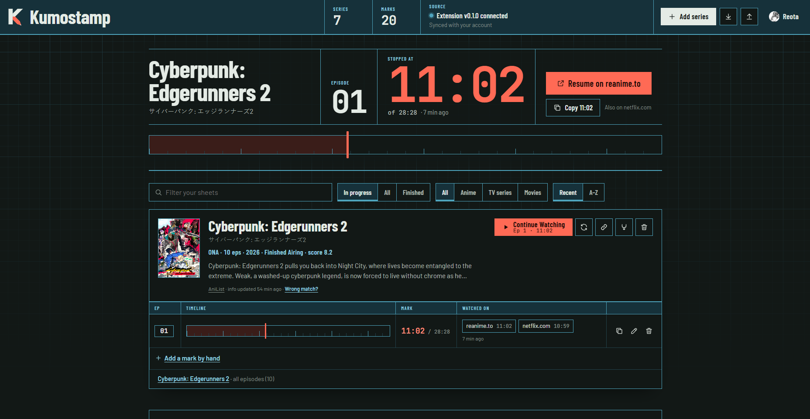
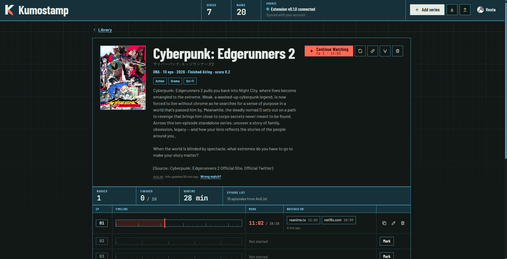

# Kumostamp

Simpan menit terakhir yang kamu tonton di anime atau series, lalu lanjutkan otomatis di situs streaming lain.




## Komponen

| Bagian | Folder | Stack & Fungsi |
|---|---|---|
| Extension | `extension/` | Chrome/Edge MV3 — deteksi video/episode, simpan mark lokal, auto-resume |
| Website & API | `web/` | React + Vite + TS, Hono on Cloudflare Workers + D1 — library, sync akun MAL/AniList |
| Discord Helper | `helper/` | Node.js — bridge lokal untuk Discord Rich Presence (opsional) |

## Menjalankan Secara Lokal

### 1. Website & API
```bash
cd web
npm install
cp .dev.vars.example .dev.vars   # isi TOKEN_KEY, MAL_CLIENT_ID, MAL_CLIENT_SECRET
npm run db:migrate
npm run dev
```
Buka `http://localhost:5173` (port harus `5173` agar extension terhubung).
- **MAL OAuth**: redirect URL `http://localhost:5173/api/auth/mal/callback`
- **AniList OAuth (opsional)**: isi `VITE_ANILIST_CLIENT_ID` di `web/.env.local`, redirect URL `http://localhost:5173/login`

### 2. Extension
1. Buka `chrome://extensions` (atau `edge://extensions`) dan aktifkan **Developer mode**.
2. Klik **Load unpacked** → pilih folder `extension/`.
3. Refresh tab website hingga header menampilkan *Extension connected*.

### 3. Discord Rich Presence (Opsional)
Butuh Discord desktop aktif. Lihat [helper/README.md](helper/README.md) untuk detail Application ID & art assets.
```bash
cd helper
cp config.example.json config.json   # isi clientId
node index.mjs
```
Aktifkan melalui onboarding website atau popup extension → **Connected accounts → Discord**.

## Deploy (Cloudflare Workers)
```bash
npx wrangler login
npx wrangler d1 create kumostamp        # salin database_id ke web/wrangler.jsonc
npm run db:migrate:remote
npx wrangler secret put MAL_CLIENT_ID   # ulangi untuk MAL_CLIENT_SECRET & TOKEN_KEY
npm run deploy
```
Daftarkan `https://<domain>/api/auth/mal/callback` di MAL dan isi `VITE_ANILIST_CLIENT_ID` di `web/.env.production` sebelum deploy.

## Catatan Pengembang
- Sinkronisasi file shared (`core.js`, `catalog.js`, `tokens.css`) antara `extension/` dan `web/`:
  ```bash
  node scripts/sync-shared.mjs
  ```
- Penjelasan arsitektur dan alur kerja lengkap: [docs/how-it-works.md](docs/how-it-works.md).
- Batasan: hanya mendukung player `<video>` HTML5, series TVmaze/IMDb tidak di-sync ke MAL/AniList, dan belum ada automated test.
